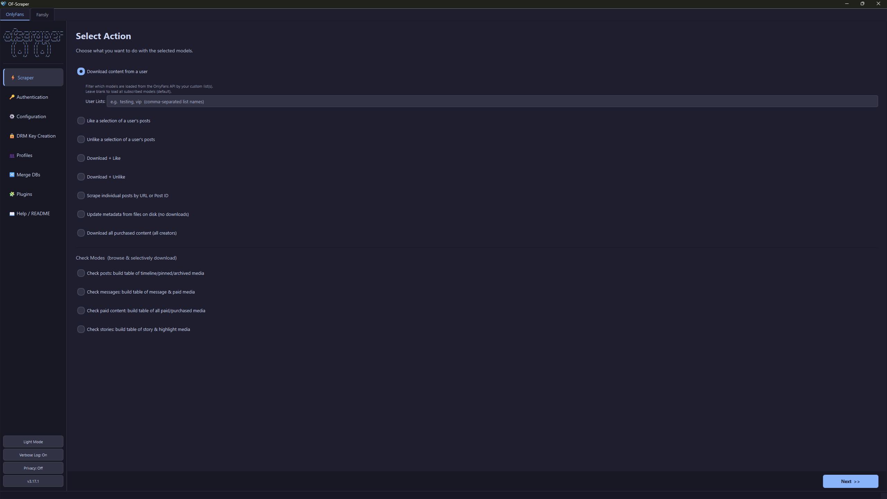
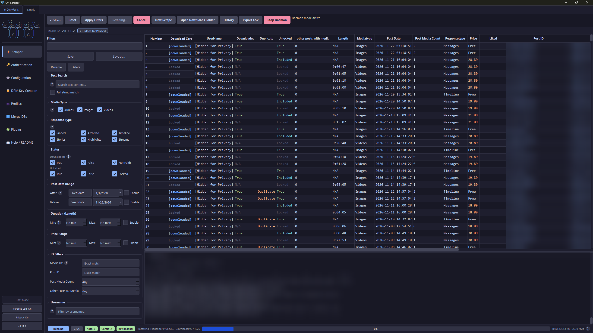
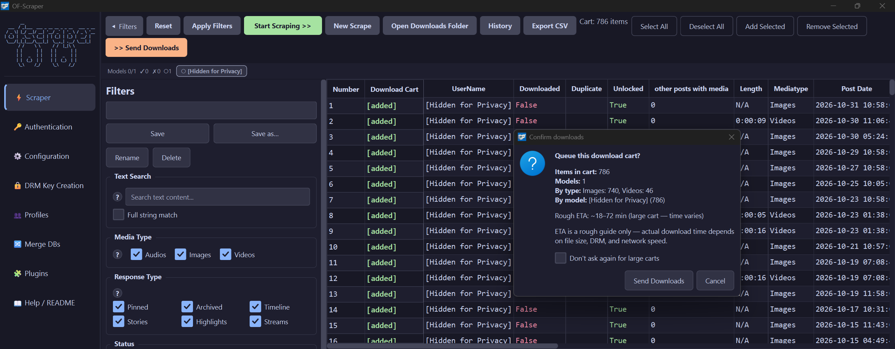
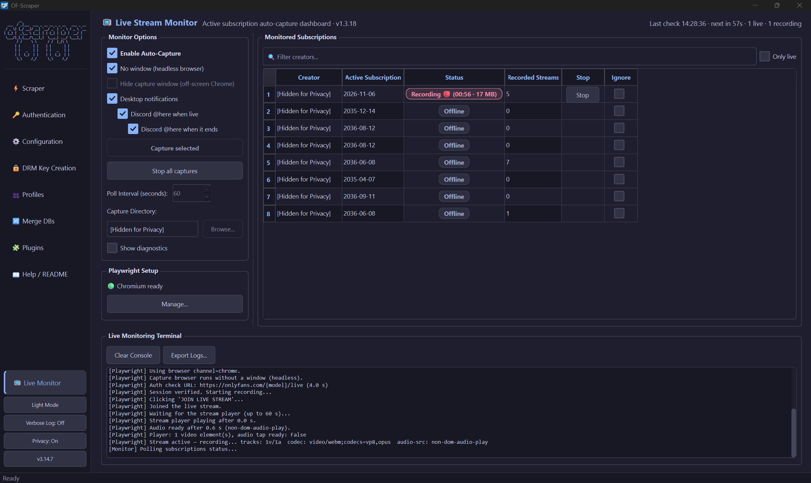
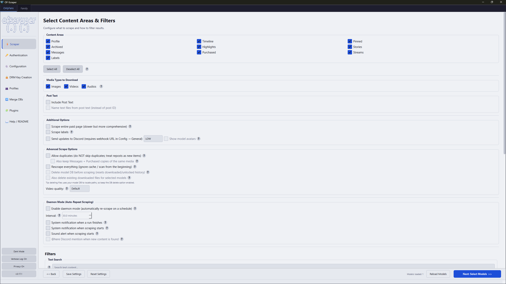
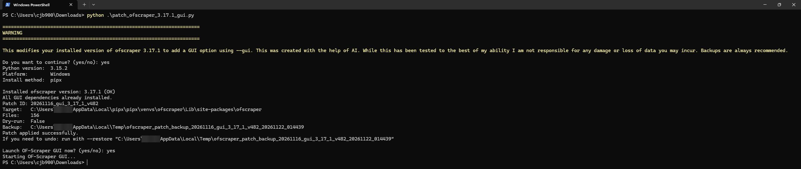

<p align="center">
  
</p>

<h1 align="center">OF-Scraper GUI</h1>

<p align="center">
  <b>A full desktop GUI for OF-Scraper: pick, browse and download from OnlyFans and Fansly in one window instead of the command line.</b>
</p>

<p align="center">
  
  
  
  
  <a href="https://github.com/cjb900/OF-Scraper-GUI/actions/workflows/codecov.yml?query=branch%3Atesting"></a>
</p>

<p align="center">
  <a href="#quick-start"><b>Get started</b></a> •
  <a href="docs/install.md">Install</a> •
  <a href="docs/gui-guide.md">GUI guide</a> •
  <a href="#docker">Docker</a> •
  <a href="docs/plugins.md">Plugins</a> •
  <a href="docs/versions.md">Versions</a> •
  <a href="docs/troubleshooting.md">Troubleshooting</a>
</p>

---

A self-contained Python script that patches an installed (non-binary) copy of [OF-Scraper](https://github.com/datawhores/OF-Scraper) to add a full **PyQt6 GUI**, opened with `ofscraper --gui`.

**Supported OF-Scraper versions:** `3.17.1` (`patch_ofscraper_3.17.1_gui.py`, recommended: OnlyFans and Fansly) and `3.14.7` (`patch_ofscraper_3.14.7_gui.py`, OnlyFans only).

> [!WARNING]
> New features go into the **3.17.1** patch; fixes that apply are also made in **3.14.7**. The patches for **3.12.9**, **3.14.3** and **3.14.5** are still in the repository but have not been updated and may not work properly. See [Versions](docs/versions.md).

<p align="center">
  
  
</p>

## Contents

- [What it adds](#what-it-adds)
- [Before you start](#before-you-start)
- [Quick start](#quick-start)
- [Docker](#docker)
- [Documentation](#documentation)
- [Notes](#notes)
- [Disclaimer](#disclaimer)

## What it adds

- **OnlyFans and Fansly in one window** (3.17.1): each site in its own tab with its own settings, login, databases and download folder, and both can scrape at the same time. Fansly covers Timeline, Messages, Purchased and Walls, and has its own check mode
- **A step-by-step scrape wizard**: pick an action, content areas and filters, and models, then watch progress in a live table and log
- **Check modes** to browse everything a creator posted (including locked items), spot files you've deleted from disk, and download only what you pick
- **Authentication made easier**: import cookies from your browser, or log in through a browser window, instead of copying headers by hand. For Fansly, **Import from browser** reads the sign-in from Firefox, Zen or Chrome on the same computer
- **Every setting in one place**, with checks that stop bad paths and file names before a scrape starts
- **Notifications**: a desktop notice when a run finishes, and Discord messages with one message per creator and a totals card
- **Update from the GUI** (3.17.1): when a newer patch is out, **Update now** downloads it, closes the GUI and applies it. **About → Include testing builds** also offers test versions
- **DRM key creation**, profiles, database merging, daemon mode, scrape history, CSV export and more
- **Plugins** (experimental): AI image tagging, an AI assistant, live stream capture and trial-link scanning
- **Docker** support: run the GUI on a server and open it in your browser

<table>
  <tr>
    <td align="center" width="33%"><br><em>Check mode</em></td>
    <td align="center" width="33%"><br><em>Live Stream Monitor plugin</em></td>
    <td align="center" width="33%"><br><em>Light and dark themes</em></td>
  </tr>
</table>

The [GUI guide](docs/gui-guide.md) walks through every page.

## Before you start

| Platform | pip | pipx | uv |
|----------|:---:|:----:|:--:|
| Windows  | ✅  | ✅   | ✅ |
| Linux (Debian-based) | ❌  | ✅   | ✅ |
| Mac OS   | ❌ | ❌  | ❌ |
| Docker   | ✅ | — | — |

❌ = not tested. Windows is tested on Windows 11; Linux on Debian-based distributions (Ubuntu, Debian, Mint, KDE neon, Pop!_OS, …).

- **Python:** 3.11 and 3.12 are supported, and newer versions also work (the patch installs OF-Scraper with Python 3.12 on Python 3.15+ for the 3.17.1 patch, and on 3.13+ for the 3.14.7 patch). **If you run into issues with a newer Python version, use Python [3.11.6](https://www.python.org/downloads/release/python-3116/)** (recommended).
- **FFmpeg** (needed for DRM videos): version 6 or newer works. **If you run into issues with a version above 7.1.1, use FFmpeg 7.1.1.**

More detail: [Install](docs/install.md).

## Quick start

**Prerequisites:** you need one of these:

- **OF-Scraper already installed** ([OF-Scraper on GitHub](https://github.com/datawhores/OF-Scraper)), or
- **If OF-Scraper is not installed:** **Python** and one of **pip**, **pipx** or **uv**, so the patch script can install OF-Scraper for you.

More detail: [Prerequisites](docs/install.md#prerequisites).

1. Download the patch script for your OF-Scraper version from this repository, e.g. `patch_ofscraper_3.17.1_gui.py`.
2. Run it. It finds your OF-Scraper install (or offers to install it), backs up the files it changes, installs PyQt6, and applies the patch:

   ```bash
   python patch_ofscraper_3.17.1_gui.py
   ```
  

3. Start the GUI:

   ```bash
   ofscraper --gui
   ```
  
  

4. In the GUI, pick the **OnlyFans** or **Fansly** tab, then: **Authentication** → log in or import your sign-in; **Configuration** → set your Save Location and FFmpeg path; then **Scraper** → pick an action and go. Each tab has its own settings, so set up both if you use both sites.

**Coming from the 3.14.7 patch?** Run the 3.17.1 patch script the same way. It upgrades OF-Scraper to 3.17.1 with the same method you installed it with (pip, pipx or uv) and keeps your settings, login and databases. The first time, the OnlyFans tab offers to move your downloads from the default folder into `OnlyFans/` next to Fansly's folder; a Save Location you set yourself is never changed.

To update later, use **Update now** in the GUI (3.17.1) or download the newer patch script and run it again. To undo the patch: `python patch_ofscraper_3.17.1_gui.py --restore /path/to/backup`. All options: [Install](docs/install.md).

## Docker

Run the GUI on a machine without a desktop and open it at `http://<host>:6699/` in your browser, or run only the command-line daemon with `MODE=cli`. On Linux:

```bash
# edit the /home/YOU/... volume paths in docker-compose.yml first
docker compose build ofscraper-gui
docker compose up -d ofscraper-gui
```


The desktop resizes to fit your browser window, and the GUI stays maximized in it: resize the window or go full screen and the GUI follows. `SCREEN_WIDTH` / `SCREEN_HEIGHT` in `docker-compose.yml` are only the starting size.

One container can scrape both sites at once: set `ONLYFANS_GUI_ARGS` and `FANSLY_GUI_ARGS` in `docker-compose.yml`. Set `VNC_PASSWORD` too if the host can be reached from other computers: without it, anyone who can open port 6699 controls the GUI.

`docker-compose.yml` uses host networking, which only works on Linux. **On Docker Desktop (Windows / macOS) you must change it first.** Setup, volumes, CDM keys, start-up options, `MODE=cli` and troubleshooting: [Docker](docs/docker.md).

## Documentation

| Guide | What's in it |
|---|---|
| [Install](docs/install.md) | Platforms, Python and FFmpeg, patch script options, how your install is detected, backups and restore, `ofscraper_tools.py` (uninstall and data clean-up) |
| [GUI guide](docs/gui-guide.md) | Every page and feature, in the order you use them |
| [Docker](docs/docker.md) | Running the GUI or the CLI daemon in a container |
| [Plugins](docs/plugins.md) | The plugin system, where to get the plugins, and each plugin's setup |
| [Versions](docs/versions.md) | Which features each patch version has |
| [Troubleshooting](docs/troubleshooting.md) | Login, DRM keys, FFmpeg, lost files, crashes |
| [Plugin development](PLUGIN_DEVELOPMENT.md) | Writing your own plugin |

The GUI also has a built-in **Help / README** page with the full reference; every **?** button in the app jumps to the matching section.

## Notes

- A backup of all modified files is saved to your system temp directory before patching; `--restore` undoes the patch.
- This was created with the help of AI and has been tested to the best of my ability. I take no responsibility for any damage or loss of data. Backups are recommended.

## Disclaimer

1. This tool is not affiliated, associated, or partnered with OnlyFans or Fansly in any way. We are not authorized, endorsed, or sponsored by OnlyFans or Fansly. All OnlyFans trademarks remain the property of Fenix International Limited; all Fansly trademarks remain the property of their owner.
2. This is a theoretical program only and is for educational purposes. If you choose to use it then it may or may not work. You solely accept full responsibility and indemnify the creator, hosts, contributors and all other involved persons from any and all responsibility.
