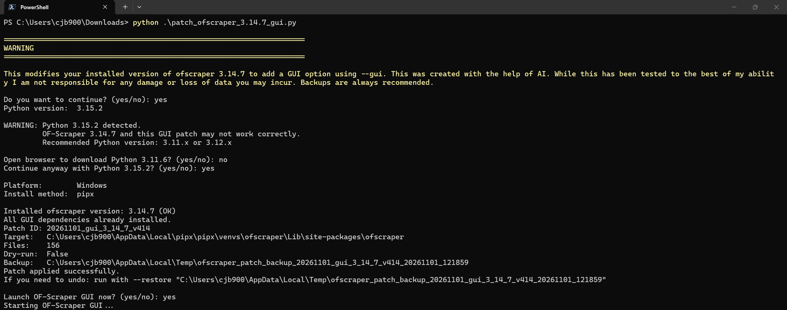
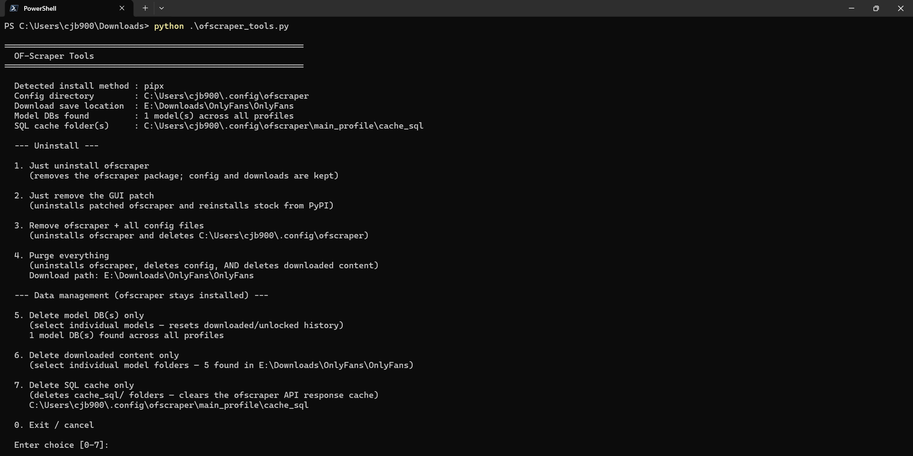

[🏠 README](../README.md) · [Install](install.md) · [GUI guide](gui-guide.md) · [Docker](docker.md) · [Plugins](plugins.md) · [Versions](versions.md) · [Troubleshooting](troubleshooting.md)

---

# Install and patch

## Prerequisites

You need one of these before running the patch script:

- **OF-Scraper-Community 3.16.4 is already installed.** It is the maintained fork of OF-Scraper ([GitHub](https://github.com/cloakedkeys/OF-Scraper-Community)), on PyPI as [`ofscraper-community`](https://pypi.org/project/ofscraper-community/). Install it with one of:
  ```bash
  pip install ofscraper-community==3.16.4
  uv tool install ofscraper-community==3.16.4
  pipx install ofscraper-community==3.16.4
  ```
  The patch script finds your install and patches it. The command is still `ofscraper`.
- **If it is not installed:** you need **Python** ([supported versions](#python-version)) and one of **pip**, **pipx** or **uv**. The patch script uses them to install `ofscraper-community` 3.16.4 from PyPI for you ([see below](#if-of-scraper-is-not-detected)).

### Moving from `ofscraper` (3.14.7 or a git install)

The `ofscraper` package on PyPI is the older upstream OF-Scraper (3.14.7), and git installs of OF-Scraper-Community 3.16.1 and older also used that name. The 3.16.4 patch does not fit them. `ofscraper` and `ofscraper-community` put their code in the same `ofscraper` folder, so **uninstall the old package first**, then install the new one, with the tool you used before:

```bash
pip uninstall ofscraper            # or: uv tool uninstall ofscraper / pipx uninstall ofscraper
pip install ofscraper-community==3.16.4   # or: uv tool install … / pipx install …
```

Your config, profiles, auth and downloads are kept: they are not in the package. If the patch script finds the old package, it shows these commands for your install method and offers to run them. For an existing 3.14.7 install, the 3.14.7 patch is still in the repository.

## Supported platforms and install methods

Check this **before** installing or patching. Unsupported or untested platforms may fail in ways that are hard to diagnose.

| Platform | pip | pipx | uv |
|----------|:---:|:----:|:--:|
| Windows  | ✅  | ✅   | ✅ |
| Linux (Debian-based) | ❌  | ✅   | ✅ |
| Mac OS   | ❌ | ❌  | ❌ |
| Docker   | ✅ | — | — |
* ❌ not tested

### Platform notes

- **Windows**: Tested on **Windows 11** but should work on Windows 10 and other versions
- **Linux**: Only **Debian-based** distributions are supported (Ubuntu, Debian, Linux Mint, KDE Neon, Pop!_OS, etc.). Other distributions (Arch, Fedora, etc.) have not been tested and may require additional setup
- **Mac**: Mac OS has not been tested with this GUI patch
- **Docker**: Runs on any host that supports Docker. The container uses Ubuntu 24.04 with TigerVNC and noVNC — no display required on the host. See [Docker](docker.md)

### Python version

- Python **3.11** to **3.15** are supported (OF-Scraper-Community 3.16.4 requires 3.11 or newer and below 3.16)
- On a newer Python, the patch script installs OF-Scraper-Community with Python 3.12 through uv or pipx, which download it if it isn't installed
- The 3.14.7 patch keeps its own rule: on Python 3.13+ it installs OF-Scraper 3.14.7 with Python 3.12
- **If you run into issues with a newer Python version, use Python [3.11.6](https://www.python.org/downloads/release/python-3116/)** (recommended)
- Python below 3.11 is **not supported**

### FFmpeg

FFmpeg is needed to merge DRM audio and video and to check downloaded files. Set its path in **Configuration → Download → FFmpeg Path**.

- FFmpeg **6 or newer** works, including FFmpeg 8
- **If you run into issues with a version above 7.1.1, use FFmpeg 7.1.1**
- Windows builds: [gyan.dev](https://www.gyan.dev/ffmpeg/builds/). Linux: your package manager (`sudo apt install ffmpeg`)
- The Docker image includes its own FFmpeg; don't mount a host copy into it

## Running the patch script

Download `patch_ofscraper_3.16.4_gui.py` from the repository root and run it with Python. If OF-Scraper-Community isn't installed yet, the script offers to install it ([see below](#if-of-scraper-is-not-detected)).

**Updating:** to move to a newer GUI patch, download the new script and run it again. It replaces the patched files and makes a fresh backup first.

```bash
# Basic usage — auto-detect and patch
python patch_ofscraper_3.16.4_gui.py

# Skip confirmation prompt
python patch_ofscraper_3.16.4_gui.py -y

# Force-reinstall OF-Scraper-Community 3.16.4 and all GUI dependencies, then patch
python patch_ofscraper_3.16.4_gui.py --force

# Force-reinstall ofscraper only (skip GUI dependency reinstall)
python patch_ofscraper_3.16.4_gui.py --force --skip-deps

# Dry run — see what would happen without making changes
python patch_ofscraper_3.16.4_gui.py --dry-run

# Specify install path manually
python patch_ofscraper_3.16.4_gui.py --target /path/to/site-packages/ofscraper

# Skip PyQt6 installation (if already installed)
python patch_ofscraper_3.16.4_gui.py --skip-pyqt6

# Restore original files from backup
python patch_ofscraper_3.16.4_gui.py --restore /path/to/backup
```

The same flags apply to `patch_ofscraper_3.14.7_gui.py`, `patch_ofscraper_3.14.5_gui.py`, `patch_ofscraper_3.14.3_gui.py`, and `patch_ofscraper_3.12.9_gui.py`, except `--force`, which only the 3.16.4 and 3.14.7 patches have (from `v409`). The 3.16.4 patch is the maintained one; the 3.14.5, 3.14.3 and 3.12.9 patches have not been updated and may not work properly (see [Versions](versions.md)).

### Repairing a broken install (`--force`)

If OF-Scraper or the GUI won't start after an interrupted or failed install, or after patching, `--force` rebuilds it from scratch and then patches it:

- **OF-Scraper-Community 3.16.4** (`ofscraper-community`) is reinstalled from PyPI with all of its dependencies, using the same method it was installed with:
  - **uv:** `uv tool install --force --reinstall`, with the GUI packages listed so they are not dropped
  - **pipx:** `pipx uninstall ofscraper-community`, then a fresh `pipx install`, so the whole venv is new
  - **pip:** `pip install --upgrade --force-reinstall`
- **GUI dependencies** (PyQt6, PyQt6-WebEngine, browser_cookie3, secretstorage, pycryptodome) are all reinstalled, even the ones that are already there
- **The GUI patch** is then applied as usual, with a new backup

With `--skip-deps`, only ofscraper is reinstalled and the GUI packages you already have are kept (pipx: reinstalled inside the existing venv). `--force --dry-run` only prints what it would reinstall. Your config, auth and downloads are not touched.

## After patching


Launch the GUI with:

```bash
ofscraper --gui
```

The patch script will also offer to launch the GUI for you immediately after a successful patch.

> **Note:** If you run the patch script from inside a source directory (e.g. `OF-Scraper-3.16.4/`), use `python -m ofscraper --gui` from a different directory (e.g. your home directory) to ensure the installed version is used rather than the local source files.

## How it detects your installation

The script automatically detects how OF-Scraper was installed by checking (in order):

1. **uv tool directories** — looks for ofscraper in `~/.local/share/uv/tools/` (Linux) or `%USERPROFILE%\AppData\Local\uv\tools\` (Windows)
2. **pipx virtual environments** — checks `~/.local/share/pipx/venvs/ofscraper-community/` (Linux) or `~\pipx\venvs\ofscraper-community\` (Windows), and the older `venvs/ofscraper/`, including the `$PIPX_HOME` environment variable
3. **Executable path** — runs `which ofscraper` / `where ofscraper` and infers the method from the path
4. **Python import** — looks up the installed `ofscraper-community` (or `ofscraper`) package and locates its `ofscraper` folder (standard pip/venv installs)

### Broken installation detection

The **3.12.9** patch script checks for broken ofscraper installations before patching, for example when a previous pip install was interrupted mid-way and left behind a corrupt `~fscraper` artifact in site-packages. When it finds one, it runs `pip install ofscraper==3.12.9 --force-reinstall` to repair it before applying the GUI patch.

The **3.16.4** and **3.14.7** patch scripts don't detect broken installs on their own. Run the script with `--force` to rebuild the install ([see above](#repairing-a-broken-install---force)).

## If OF-Scraper is not detected

If the script cannot find an existing installation, it presents an interactive menu:

```
ofscraper was not detected on this system.
(OF-Scraper-Community is on PyPI as 'ofscraper-community': pip install ofscraper-community==3.16.4)

Choose an option:
  1) Install OF-Scraper-Community 3.16.4 with pip
  2) Install OF-Scraper-Community 3.16.4 with pipx
  3) Install OF-Scraper-Community 3.16.4 with uv
  4) Specify install path manually (ofscraper is already installed)
  5) Exit

Enter choice (1-5):
```

- **Options 1-3** install `ofscraper-community==3.16.4` from PyPI using your chosen package manager, then continue with patching
- **Option 4** lets you provide the path to your ofscraper package directory manually (e.g. `/path/to/site-packages/ofscraper`). The script validates the path contains `__main__.py` before proceeding
- You can also use `--target /path/to/ofscraper` to skip detection entirely

## OF-Scraper Tools



A standalone maintenance and removal tool (`ofscraper_tools.py`) is included. It detects your install method automatically (uv / pipx / pip) and presents two groups of options.

**Run it with:**

```bash
python ofscraper_tools.py
```

### Uninstall options

1. **Just uninstall ofscraper** — removes the package only; config and downloaded content are kept
2. **Just remove the GUI patch** — uninstalls the patched version and reinstalls stock ofscraper from PyPI; your config is kept
3. **Remove ofscraper + all config files** — uninstalls ofscraper and deletes `~/.config/ofscraper/` (includes settings, auth, logs, and databases — everything ofscraper stores outside your download folder)
4. **Purge everything** — uninstalls ofscraper, deletes config, and deletes your downloaded content. The download path is read from `file_options.save_location` in `config.json` **before** the config is deleted, so the correct path is always used regardless of where you saved content

### Data management options *(ofscraper stays installed)*

5. **Delete model DB(s) only** — lists every individual model database found across all profiles, showing the creator's username (read directly from the DB) and their numeric ID. You can delete one, several (comma-separated), or all. Only the selected model's `.data/<id>/` folder is removed, leaving all other models and your downloaded files untouched. Resetting a model's DB causes ofscraper to treat all of that creator's content as new on the next run
6. **Delete downloaded content only** — lists every model folder found inside your download root (`file_options.save_location` in `config.json`), along with each folder's total size on disk. You can delete one, several (comma-separated), or all. Only the selected folders are removed; config and model DBs are not affected. Requires two confirmations. Prompts for the download path if it cannot be read from `config.json`
7. **Delete SQL cache only** — deletes the `cache_sql/` folder(s) under each profile (`~/.config/ofscraper/<profile>/cache_sql/`). The cache holds API responses that speed up repeated runs; clearing it forces ofscraper to re-fetch everything from the API on the next run. Config, model DBs, and downloaded files are not affected

All destructive options require explicit confirmation before proceeding. Options 4, 5, and 6 require two confirmations.

> **Note:** `uninstall_ofscraper.py` (the previous name for this script) is superseded by `ofscraper_tools.py`.

## Backups and restore

- A backup of all modified files is saved to your system temp directory before patching
- The `--restore` flag can undo the patch using any previous backup
- PyQt6 is installed automatically via the same package manager used for OF-Scraper (pip/pipx inject/uv)
